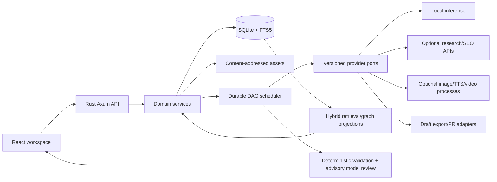

# System architecture and scope

## Product contract

Local-first creative application turning **research → verified knowledge → publishable content → measured learning**. Multiple brands, arbitrary-depth projects, categories, languages (English/Japanese first), target audiences and reusable assets. Outputs: researched articles/MDX, SEO briefs, SVG/PNG illustrations and diagrams, narrated 16:9/9:16 explainers, slide videos, thumbnails, character-based media, interactive lessons/course bundles and eventual commercial releases. Each output is editable, versioned, reproducible where possible and source-backed.

**Out of scope initially:** custom graph database, fully automatic publication or payment handling, live social CRM, heavyweight generative video, unrestricted web crawler, general-purpose 3D editor, large-scale multi-user SaaS, dozens of half-implemented providers.

## Brand/media product boundaries (video-first integration)

A BrandKit is a versioned approval-bound identity spanning semantic visual tokens, type/asset rights, motion direction, editorial persona, logical narrator, SFX/music palette and platform layout policy. Projects inherit a pinned approved BrandKit revision and may override only permitted traits. An episode may select a mood; the destination selects a DeliveryProfile; neither silently mutates approved identity. See [12](12-brand-studio.md).

ContentGen orchestrates research, script/beat documents, provider-neutral audio, rights, jobs, brand revisions and final mux/publish. Kumiki is consumed as pinned source-distributed **visual/media/motion primitives**, not as a second backend or a competing application. Its comprehensive Composition wire schema is still partly proposed; integrate only implemented surfaces. [14](14-kumiki-integration.md) specifies the boundary. Audio adapter requirements are in [13](13-audio-production.md).

## Topology



**Rust owns** data, approval, source rights, jobs, artifact hashes, migrations, typed schemas and resource limits. **React owns** responsive creation/editing, timeline/scene controls and preview. **Adapters** own vendor-specific APIs/process invocation; optional tools do not block app startup. **SQLite is canonical**; FTS/vector indexes and graph views are rebuildable projections. Models can be local but SEO search and analytics still need user-authorized network access.

## Suggested repository (create only when needed)

```text
apps/api/                  # Axum startup/HTTP, auth/origin validation
apps/web/                  # React/Vite workspace; accessible UI
crates/domain/             # owned model types, invariants, schema versions
crates/storage/            # SQLite repositories, migrations, artifact store
crates/workflow/           # DAG engine, checkpoints, resources, leases
crates/providers/          # capability ports; optional adapter features
crates/research/           # ingestion, retrieval, claims, SEO
crates/content/            # article, lesson, course, publishing plans
crates/media/              # scene/timeline schemas, QA and render requests
crates/catalog/            # hierarchy, characters, products/releases
crates/quality/            # findings, release gates and measurements
adapters/                  # optional TS/Python tools using typed IPC
examples/                  # fixtures, small reproducible samples
data/                      # local DB/artifact roots, ignored by Git
```

Keep a single Cargo workspace; crates import domain/ports, never concrete adapters. Prefer one executable and a few optional worker processes over permanent microservices. Don't scaffold empty crates to satisfy the diagram.

## Ownership and boundary rules

- **Brand owns projects**; each project optionally has a same-brand parent. Content belongs to projects; research collections can link permitted sources across projects. Characters are stable identity/version records, optionally brand-owned or workspace-shared.
- **Product is not a folder:** it references exact artifact/content versions in immutable release bundles. Stripe is a later commerce adapter.
- Content, character, thumbnail, slide, and animation documents are versioned structured inputs; SVG/PNG/MP4/WAV are derived outputs. Regenerating one section or scene only invalidates its dependents.
- Source passage + observation timestamps are evidence; AI-generated summaries and relationships remain tentative until verified. Store contrary evidence and uncertainty.
- External effects (SEO charges, remote publication, email, external assets) require explicit capability grants, budgets and human approval.

## Performance budgets (initial targets, benchmark instead of promising)

UI gives immediate input feedback; never blocks on inference/render; navigation and editing preserve state. Use asynchronous background jobs and truthful status. Default max one large inference and one heavy renderer, with adjustable concurrency after measurement. On a 24 GB Mac, start LLM contexts around 8–16K, run heavy models sequentially and preflight free RAM/disk before jobs. Published assets and approved character rigs are durable; disposable render frames are not.
