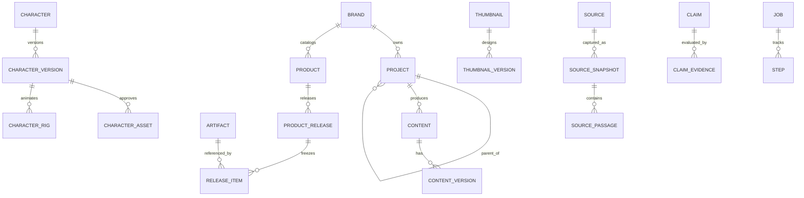

# Data model, migrations and identity invariants

**Canonical store:** SQLite (`PRAGMA foreign_keys=ON` on **every connection**). Use migrations, parameterized SQL, stable ULIDs/UUIDs, UTC timestamps, explicit ownership, WAL when suitable. Keep large files outside DB; `artifacts` stores SHA-256, owned path/URI, size, MIME, rights, retention and metadata. FTS5, vectors and graph views are derived indexes. Source code schemas must be validated on all JSON ingress.

## Ownership graph

**Logical entities:**

| Group | Key tables/records | Non-negotiable invariant |
|---|---|---|
| Organization | `brands`, `projects`, `project_asset_links` | Arbitrary-depth same-brand parent, reject cycles, keep cross-project asset links not bytes |
| Content | `topics`, `contents`, `content_versions`, `content_assets`, `artifacts` | Exact revision and input provenance; export does not overwrite source |
| Characters | `characters`, `character_versions`, `character_names/assets/rigs/voices/appearances`, `animation_clips` | Identity stable through project moves; approved references immutable; localized aliases; rights for sharing |
| Thumbnails | `thumbnails`, `thumbnail_versions` | Editable scene specification, platform/variant revision, single approved default per profile; standalone allowed |
| Catalog | `products`, `product_variants`, `product_releases/items`, `commercial_offerings`, `commerce_external_refs` | Products ≠ folders, approved releases frozen; payment IDs never local PKs |
| Research | `sources`, `source_snapshots`, `source_passages`, `research_collections/notes/questions/runs`, `claims/evidence` | Immutable timestamped source version + exact passage locator; duplicate links not bytes |
| SEO | `seo_keywords/metric_snapshots/serp_snapshots/results/clusters/content_targets` | Metric provider/date/country/language/device/schema required; null ≠ zero |
| Analytics | `analytics_import_runs`, `metric_observations`, `content_experiments/variants` | Scope, window, unit, completeness; no fabricated attribution |
| Graph | `graph_nodes/edges` | Derived suggestions + provenance/temporal validity; never replace canonical IDs |
| Execution | `jobs`, `steps`, `step_dependencies`, `provider_profiles`, `qa_findings`, `approvals`, `publish_attempts` | Idempotency, approvals, audit and repair possible after restart |

## SQL fixtures

- [`core-schema.sql`](../examples/core-schema.sql) is the **full legacy baseline DDL** translated from the prior documentation. It contains the table/trigger definitions above; use it as a reference, split into ordered migrations, and test ordering/forward keys.
- [`research-intelligence.sql`](../examples/research-intelligence.sql) is the **additive research/SEO/analytics schema**. Requires core tables; run **after** baseline. Never apply raw fixture SQL destructively to existing user DBs.
- JSON examples: `character-profile`, `thumbnail-spec`, `visual-scene`, `product-release`, `research-collection`, `seo-opportunity`, `article-job`, `provider-profiles`, `design-tokens`, `premium-visual-brief`.

## Constraints requiring application logic or triggers

1. Reject same-node or ancestor cycles and **any** project parent/child brand mismatch, even direct SQL writes; preflight move/deletion impact and undo.
2. Published/approved release manifest and item list are immutable; create a new version to update. Verify frozen content version + asset hash + rights and render parameters.
3. Cross-brand reference authorization and third-party rights cannot be guaranteed by FK alone. Shared characters still carry explicit permission metadata.
4. Use transaction to switch one approved/default thumbnail for a platform; prevent concurrent defaults. Keep all variant history.
5. Source snapshot keyed by source, normalized content hash, parser version and retrieved time; passage locators reference snapshot, not mutable live URLs.
6. SEO observations are append-only in time. A change to volume or rank makes a **new observation**, not an overwrite of history.
7. Graph edges include source and validity, proposals must not masquerade as verified facts. Limit traversals in request paths; `petgraph` is optional for bounded graph algorithms.
8. Review data retention, reverse links and published usage before delete; no cascading delete of approved products or canonical evidence due to cleanup.

## Migration acceptance

Fresh install + upgrades from prior schemas with backups, `PRAGMA integrity_check`, `PRAGMA foreign_key_check`, cycle/direct SQL trigger tests, approved-release mutation denial, duplicate thumbnail defaults, source snapshot history, FTS insert/update/delete and recovery on failure. `examples/` is **not** runtime migration registration. Add tests for dataset of ≥1,000 project nodes and cross-project asset use. Record migration source and destination versions; never infer absence of user data from a missing table.
