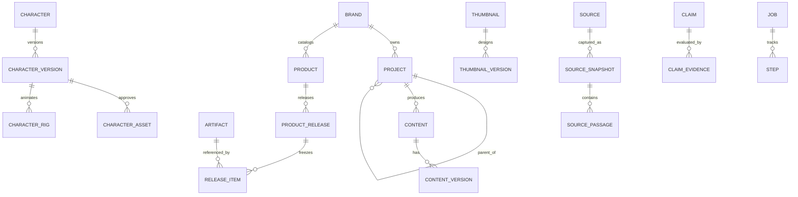

# Data model, migrations and identity invariants

**Canonical store:** SQLite (`PRAGMA foreign_keys=ON` on **every connection**). Use migrations, parameterized SQL, stable ULIDs/UUIDs, UTC timestamps, explicit ownership, WAL when suitable. Keep large files outside DB; `artifacts` stores SHA-256, owned path/URI, size, MIME, rights, retention and metadata. FTS5, vectors and graph views are derived indexes. Source code schemas must be validated on all JSON ingress.

## Ownership graph

**Logical entities:**

| Group | Key tables/records | Non-negotiable invariant |
|---|---|---|
| Organization | `brands`, `projects`, `project_asset_links` | Arbitrary-depth same-brand parent, reject cycles, keep cross-project asset links not bytes |
| Content | `topics`, `contents`, `content_versions`, `content_assets`, `artifacts` | Exact revision and input provenance; export does not overwrite source |
| Characters | `characters`, `character_versions`, `character_names/assets/rigs/voices/appearances`, `animation_clips` | Identity stable through project moves; approved references immutable; localized aliases; rights for sharing |
| Thumbnails | `thumbnails`, `thumbnail_versions` | Editable scene specification, platform/variant revision, single approved default per profile; standalone allowed |
| Catalog | `products`, `product_variants`, `product_releases/items`, `commercial_offerings`, `commerce_external_refs` | Products ≠ folders, approved releases frozen; payment IDs never local PKs |
| Research | `sources`, `source_snapshots`, `source_passages`, `research_collections/notes/questions/runs`, `claims/evidence` | Immutable timestamped source version + exact passage locator; duplicate links not bytes |
| SEO | `seo_keywords/metric_snapshots/serp_snapshots/results/clusters/content_targets` | Metric provider/date/country/language/device/schema required; null ≠ zero |
| Analytics | `analytics_import_runs`, `metric_observations`, `content_experiments/variants` | Scope, window, unit, completeness; no fabricated attribution |
| Graph | `graph_nodes/edges` | Derived suggestions + provenance/temporal validity; never replace canonical IDs |
| Execution | `jobs`, `steps`, `step_dependencies`, `provider_profiles`, `qa_findings`, `approvals`, `publish_attempts` | Idempotency, approvals, audit and repair possible after restart |

## Creative-production schema extension (v1 proposed; tested as additive SQLite fixture)

[examples/creative-production.sql](../examples/creative-production.sql) defines **additional** relational records for Brand Studio, creative packaging and media production. It is a schema **fixture**, not an executed migration. It requires the baseline [core-schema.sql](../examples/core-schema.sql) before it; [research-intelligence.sql](../examples/research-intelligence.sql) is an independent optional branch and should be installed separately. Do not execute all sample DDL against a user database.

| Owner | New tables | Why structured / constraints |
|---|---|---|
| Brand and delivery | `brand_kits`, `brand_kit_revisions`, `project_brand_kits`, `delivery_profile_revisions` | One pinned approved kit per project; revision, variant geometry/fps and immutable brand/profile approvals |
| Narration identity | `voice_profiles`, `voice_profile_revisions`, `voice_provider_mappings` | Stable branded voice separate from Fish/local/imported backend; grant/license status per mapping |
| Rights and sound | `asset_rights_reviews`, `sound_assets`, `sonic_palette_revisions` | Sound classification, immutable license review snapshots, separate brand sonic palettes |
| Discovery and packaging | `market_video_snapshots`, `creative_briefs`, `packaging_hypotheses` | Dated public title/view snapshot distinct from internal analytics; factual promises, thumbnail concepts and payoff IDs |
| Narrative/visual | `story_revisions`, `story_beats`, `scene_documents` | Stable beat/event IDs, approved story immutability, one scene format per target; **Kumiki owns keyframes** |
| Voice and mix | `audio_productions`, `speech_segments`, `audio_cues`, `audio_mixes` | Sample-accurate narration/SFX and mastering outputs, actual alignment precision and immutable mixes |
| Render and release | `video_renders`, `video_release_revisions`, `video_release_assets`, `video_publication_attempts` | Pinned story, kit, profile, audio and exact output; rights-checked approval; immutable release and separately tracked idempotent remote effects |

**Canonical relationships:** `brand → brand_kit → approved_revision → project_binding`; `project → creative_brief → packaging_hypothesis → story_revision → story_beats`; `story_revision + delivery_profile → scene_document → video_render`; `story_revision + voice_profile → speech_segments/audio_cues → audio_mix → video_render`; `render + approved packaging + rights snapshots → video_release_revision → independent publication_attempts`.

**Normalization choice:** searchable identity, revision/version, FK relationships, observed metrics, ordered beats and sample offsets use columns; flexible art direction, provider options, semantic layouts, creative concepts and render manifests use `json_valid()`-guarded JSON with `schema_version` and **application-level typed JSON Schema validation**. Do not invent an array of relational tables for every Kumiki transform or font style. Preserve global `artifacts` as content-addressed bytes and the source of hashes—never store WAV/MP4/frame blobs directly in SQLite.

**Database-level rules already in the fixture:** `ON DELETE RESTRICT` on canonical provenance; foreign keys; cross-brand project binding validation; approved BrandKit/voice/profile/story/sonic revisions and release immutability; story→hypothesis same-brief guard; speech beat→story guard; scene/render profile/story and audio/story matching; nonnegative samples and positive frame rates; release→project/hypothesis matching; release asset license-review matching and approval rejection for unreviewed/denied rights; idempotency key uniqueness for publishing. JSON content hashes are declared but **hash verification belongs to the application/artifact store**.

**Deliberately app-enforced (not falsely attributed to SQLite):** provider account consent and secrets; current remote commercial terms; external rights revocation after an earlier license approval; full asset-manifest completeness; CJK/font coverage, color contrast, premium aesthetic quality; comparative thumbnail distinctiveness, factual claims and hook→payoff consistency; clock conversion from sample time to rational FPS and word-alignment accuracy; entire DAG dependency-cycles, user/workspace ACLs and smart partial regeneration; external API idempotency beyond local key uniqueness. Persist QA findings in baseline `qa_findings` and input hashes/tool versions in job/result manifests.

**Important legacy compatibility:** `brands.tokens_json`, `brands.voice_json`, `character_voices`, and `thumbnail_versions` are baseline legacy/adjacent shapes; approved BrandKit/VoiceProfile revisions become canonical for *new* media rather than renaming/dropping those columns. Existing `analytics_import_runs/metric_observations/content_experiments` stay in the **research-intelligence** optional extension; do not duplicate private Studio metric observations in `market_video_snapshots` (public, observed title/view data only).

### Migration implementation order for OpenCode

- **F02 foundation:** migrate only necessary baseline tables (`brands`, `projects`, `artifacts`, `jobs`, `steps`, QA approvals) with actual ordered migration files and `PRAGMA foreign_keys=ON` on every connection. Do not paste reference schemas into a single startup command.
- **B01–B04:** brand kits/revisions/binding, delivery profiles, approved immutability, and verified token schemas.
- **C01–C06:** market snapshots, creative briefs, hypotheses, story revisions/beats, selected thumbnail references. Add scene documents at K02 when a renderer adapter is verified.
- **A01–A06:** logical voice revisions/mappings, immutable rights reviews, sound library/sonic palettes, samples/cues/mix output.
- **K01–K05/P01–P03:** scene documents, render result, versioned delivery profile, video release/assets, QA rights gate; add publication attempts only when an explicit destination adapter is introduced.
- **S01–S04:** cache/provenance and analytics observation from optional research extension. Backfill or upgrade legacy data transactionally; do not infer unowned rights/voice approvals.

Before a migration: inspect actual `sqlite_schema` + `PRAGMA user_version`, backup existing database, plan online-compatible additive changes, apply transactionally, run `PRAGMA foreign_key_check` and `PRAGMA integrity_check`, reopen with old data and test approval updates/deletes, cross-brand writes and rollback after a forced failure. For brand kit changes, create a **new revision**, not an `UPDATE` on approved JSON.

**Local SQL validation status:** the additive fixture was parsed/executed in SQLite against minimal compatible parent-table stubs with seeded successful and failing writes. It passed `foreign_key_check` and `integrity_check`. This is **not** proof that every historical schema upgrade has been run against the complete baseline or a production database. Integration tests must apply real ordered migrations against a disposable DB containing actual baseline data.

## SQL fixtures

- [`core-schema.sql`](../examples/core-schema.sql) is the **full legacy baseline DDL** translated from the prior documentation. It contains the table/trigger definitions above; use it as a reference, split into ordered migrations, and test ordering/forward keys.
- [`research-intelligence.sql`](../examples/research-intelligence.sql) is the **additive research/SEO/analytics schema**. Requires core tables; run **after** baseline. Never apply raw fixture SQL destructively to existing user DBs.
- [`creative-production.sql`](../examples/creative-production.sql) is the **additive media, audio, branding and packaging schema**. Requires core tables; research-intelligence is optional. Split into milestone-specific ordered migrations.
- JSON examples: `brand-kit`, `brand-style-presets`, `packaging-experiment`, `audio-production-job`, `character-profile`, `thumbnail-spec`, `visual-scene`, `product-release`, `research-collection`, `seo-opportunity`, `article-job`, `provider-profiles`, `design-tokens`, `premium-visual-brief`.

## Constraints requiring application logic or triggers

1. Reject same-node or ancestor cycles and **any** project parent/child brand mismatch, even direct SQL writes; preflight move/deletion impact and undo.
2. Published/approved release manifest and item list are immutable; create a new version to update. Verify frozen content version + asset hash + rights and render parameters.
3. Cross-brand reference authorization and third-party rights cannot be guaranteed by FK alone. Shared characters still carry explicit permission metadata.
4. Use transaction to switch one approved/default thumbnail for a platform; prevent concurrent defaults. Keep all variant history.
5. Source snapshot keyed by source, normalized content hash, parser version and retrieved time; passage locators reference snapshot, not mutable live URLs.
6. SEO observations are append-only in time. A change to volume or rank makes a **new observation**, not an overwrite of history.
7. Graph edges include source and validity, proposals must not masquerade as verified facts. Limit traversals in request paths; `petgraph` is optional for bounded graph algorithms.
8. Review data retention, reverse links and published usage before delete; no cascading delete of approved products or canonical evidence due to cleanup.

## Migration acceptance

Fresh install + upgrades from prior schemas with backups, `PRAGMA integrity_check`, `PRAGMA foreign_key_check`, cycle/direct SQL trigger tests, approved-release mutation denial, duplicate thumbnail defaults, source snapshot history, FTS insert/update/delete and recovery on failure. `examples/` is **not** runtime migration registration. Add tests for dataset of ≥1,000 project nodes and cross-project asset use. Record migration source and destination versions; never infer absence of user data from a missing table.
