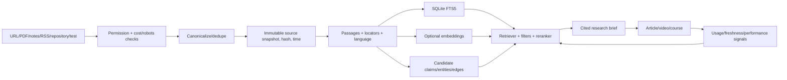

# Research Hub, knowledge graph and SEO intelligence (P0)

**Purpose:** every research run adds reusable, searchable evidence—rather than another disconnected AI summary. Search user notes, imported sources, source passages, claims, technical experiments, keyword opportunities, project content and publishing outcomes with traceable provenance.

## Ingestion → evidence



**Persistence:** `sources` (origin/rights), `source_snapshots` (retrieved timestamp, raw artifact, content hash, normalization version), `source_passages` (text, page/line/offset/DOM locator, language), notes/questions/collections (links, not duplicate bytes), research runs with budgets and source IDs, claims with **support/refute/unknown** evidence edges, author/reviewer status, validity dates. Experiments store fixtures, environment, code and outcomes. The source's current web URL does not replace immutable retrieved text.

**User workflows:** capture selected text or import local files; group sources into reusable scoped collections; search across project/brand/workspace with authorization, locale/date/source-kind/status filters; open results at the exact cited passage; ask the library a question and receive evidence-linked answers with conflicts, gaps and uncertainty; compare changed source snapshots; export a portable evidence manifest. External discovery results are *leads* until actually fetched and stored. Show preview/context before using private documents with a model.

## Retrieval sequence

1. **Offline first:** SQLite FTS5 with unicode tokenizer, tuned BM25, filtered lexical retrieval + snippets and exact phrase support; maintain small representative test corpus. Search title/alias/keyword and passage body; show matched terms and dates.
2. Optional embeddings via an interchangeable provider + `sqlite-vec`; record embed model/version, source hash, chunker version and permissions. Invalidate/rebuild on change; never silently reuse incompatible vectors. Hybrid fusion (e.g. reciprocal rank fusion) and reranking must preserve source locators.
3. Optional typed graph (`graph_nodes/edges` + bounded traversal) for topic/prerequisite/claim/article/keyword/character relationships, temporal validity and contradiction review. Inferred entity candidates need approval. Graphiti, Cognee, LightRAG or a custom Rust extractor remain **swappable experimental adapters**, not the data model.
4. Measure recall@k, evidence citation precision, false support, duplicate ratio and p95 search latency on seeded question/answer fixtures. If index unavailable, return limited lexical results—not unsupported fluent answers.

## SEO observation model

**Separate first-party performance from third-party market estimates.** Search Console yields site-scoped clicks/impressions/CTR/position for given query/page/date/country/device, possibly incomplete/delayed/aggregated. OpenSEO/DataForSEO may provide keyword volume, SERP result lists, bids and vendor-specific difficulty estimates. They **are not the same metric**. Maintain original unit, calculation/provider, dates, market, device, data coverage and raw response hash.

| Entity | What to record / never infer |
|---|---|
| Keyword | Normalized phrase, locale, country, engine, intent, synonyms |
| Keyword metric snapshot | Observed date/provider/market/device; volume period, CPC/currency, paid competition, provider organic difficulty **separately**; `NULL` means unknown |
| SERP snapshot/result | Query, timestamp, locale/device, rank/result type, title/URL/snippet; SERPs change; respect provider ToS |
| Content cluster | Primary/supporting keywords, search intent, topic, linked content, multilingual variants |
| Opportunity | Evidence references, current coverage, estimated effort/impact, cost, competing pages, cannibalization warning, confidence |
| Owned-site performance | GSC dimensions, raw/aggregated metrics, freshness/completeness flags; not blanket traffic extrapolation |

**Research discovery pipeline:** collect seed topics from questions and site content → expand via allowed autocomplete/search APIs/available SEO providers → cluster by intent/locale → inspect actual SERPs and primary sources → prioritize relevance, original demonstration potential, achievable ranking, business fit and cost → save brief and missing-evidence tasks → produce content → observe results. Weighted opportunity scores are **internal heuristics**, not ground truth; allow manual ranking and clear source of every input.

**Offline behavior:** import exported keyword CSV / Search Console data; manually enter hypotheses; use stored observations and lexical search. Missing external credentials = disabled integration, not fabricated volumes. Paid calls display budget cap; cache vendor responses with expiry, only spend when approved.

### Implemented: local public YouTube niche observations

The opt-in YouTube Intelligence tab tracks named search phrases via the official YouTube Data API v3 when `CONTENTGEN_YOUTUBE_API_KEY` is set **and** a watchlist is enabled. The in-process Rust worker polls while the local server runs. The API records per-run source URL, video/channel identifiers, publication time, provider, observation time, duration, and nullable public views/likes/comments/subscriber counts in SQLite. These are observations, not impressions, creator analytics, search volume or revenue. Manual collection uses the same conservative search-call budget. It is disabled by default, limited to 10 enabled watchlists and 20 search requests in a rolling 24 hours; observation rows expire after 30 days.

Current editor handoff is deliberately narrow: **Use for video** creates an editable, user-authored title and a source-inspiration link in the local Content catalog. It does not yet automatically rank opportunities, synthesize a video brief, choose hooks or generate media from competitors. A later research-to-video compiler should use dated, attributable evidence and fresh independent sources, label heuristic scores as heuristic, and require editorial review before a script is produced.

**Studio discovery idea comparison:** saved session ideas expose an `evidence-readiness-v1` advisory score, distinct from market opportunity. Its source component counts up to three frozen captured passages (20 points each) and up to three public YouTube source leads (10 points each), capped at 60; the AI draft's stated confidence contributes 5/10/20, and nonempty hook/premise/why-now fields contribute 8/8/4. With no usable source, the score is unknown. Neither source count nor public video views establish audience demand, search volume, CTR or revenue; those remain explicitly unknown. A run pins its formula version, historical runs without a version use v1, and later formulas must preserve the v1 evaluator rather than reinterpret old sessions. Select Idea highlights up to three eligible research-ready ideas and keeps all others accessible; dismissed or already selected ideas are not recommendations.

**Implemented: Discovery opportunity evidence v2:** automatic saved-idea enrichment expands editorial titles into up to two short viewer-intent YouTube queries. The second query is used only when the first lacks diverse, relevant, same-format comparables, and each `search.list` call reserves from the *same* 20-calls/rolling-day pool as YouTube Intelligence. Results are deduplicated and source queries shown. Low-coverage YouTube searches are not interpreted as low demand. The collector may fetch up to 20 official uploads for each of three observed channels (`channels.list` → `playlistItems.list` → `videos.list`), comparing views per lifetime day to other **same-format** uploads of those channels. A one-channel benchmark supports only a labeled *provisional/low-confidence* score, never a measured opportunity forecast. A robust within-session percentile continues to require three comparably sampled ideas, eight usable videos and three channels per idea. Google Trends remains independently nullable and is not imputed. `videos.list` refreshes existing video IDs on separate bounded reservations; 7/30-day growth is shown **only after real dated observations**, never inferred by dividing lifetime views by age. Recent public comment questions are brief, attributed, sanitized prompts for audience research, not validated audience-demand counts. These observations do not expose YouTube impressions, CTR, recommendation reach, retention or ad revenue.

**Optional Google Ads Keyword Planner (Google Search, not YouTube):** Enable the *Google Ads API* for the OAuth client's Google Cloud project and obtain access for the Google Ads customer. Grant the user OAuth scope `https://www.googleapis.com/auth/adwords` and generate a refresh token through the normal Google OAuth consent flow. Set the following **server-side** environment variables before starting ContentGen (customer IDs are ten digits without hyphens):

```text
CONTENTGEN_GOOGLE_ADS_CUSTOMER_ID=<10-digit-customer-id>
CONTENTGEN_GOOGLE_ADS_CLIENT_ID=<google-oauth-client-id>
CONTENTGEN_GOOGLE_ADS_CLIENT_SECRET=<google-oauth-client-secret>
CONTENTGEN_GOOGLE_ADS_REFRESH_TOKEN=<google-oauth-refresh-token>
# Only if accessing a customer through a manager account:
CONTENTGEN_GOOGLE_ADS_MANAGER_ID=<10-digit-manager-customer-id>
```

The integration is off when these are absent. The v26 `GenerateKeywordIdeas` API uses US/English Google Search targeting, up to two saved topic phrases per idea, and records bounded keyword variants, estimated *Google monthly searches*, paid-ad competition and bid ranges separately from YouTube measures. The collector caps collection at eight ideas per Discovery run; successful observations cache for 30 days and provider errors cool down, including a one-day cooldown after the per-run cap. Historic completed sessions can be backfilled after configuration. No refresh token, access token, HTTP response body or personal comment author is persisted in SQLite. Google retired developer tokens in September 2026; API access is tied to the enabled Google Cloud project. Verify project access and the required OAuth scope in the [Google Ads API quickstart](https://developers.google.com/google-ads/api/docs/get-started/introduction) and [keyword ideas guide](https://developers.google.com/google-ads/api/docs/keyword-planning/generate-keyword-ideas). Missing, denied and low-volume data stay distinct. OAuth access is **not** automatically provisioned by ContentGen; live Google Ads data requires your own authorized project and account.

**Current job boundary:** enrichment runs under the existing Discovery run's durable `measure_market`/`measure_market_collecting` state, retaining cancellation and restart recovery. Individual providers are not yet first-class nodes in the separate generic Jobs page; that remains part of the unified job-system migration. No headless YouTube scraping is used.

**Search and provenance UI:** one primary search, saved queries, collection sidebar, compact filter chips, ranked snippets with evidence badges and observation date, source comparison, conflict queue, SEO opportunity queue and create-from-brief action. Avoid large unexplained dashboards or invisible source confidence scores.

**Freshness and privacy:** research permissions, robots/ToS, host and rate limits, timeout, dedupe and content rights are checked before crawl; retrieved HTML is untrusted prompt data. Version changed sources; recompute dependency impact to claims/content, propose edits rather than alter approved assets. Don't crawl private/authenticated pages without authorization or send private research to unapproved remote models.

**Acceptance:** import two versions of one source, identify changed passage, answer with exact snapshot citations, preserve contradictory claims, demonstrate FTS hit + filters offline, store keyword history from fixture CSV without invented metrics, show source-backed article opportunity. Test query/market/date uniqueness, rights-denied cross-project search, restart recovery, duplicate URL normalization and citation drift.

References: [SQLite FTS5](https://www.sqlite.org/fts5.html), [sqlite-vec](https://github.com/asg017/sqlite-vec), [Google Search Console API](https://developers.google.com/webmaster-tools), [OpenSEO](https://github.com/every-app/open-seo), [DataForSEO](https://dataforseo.com/), [Google Search content guidance](https://developers.google.com/search/docs/fundamentals/creating-helpful-content).

