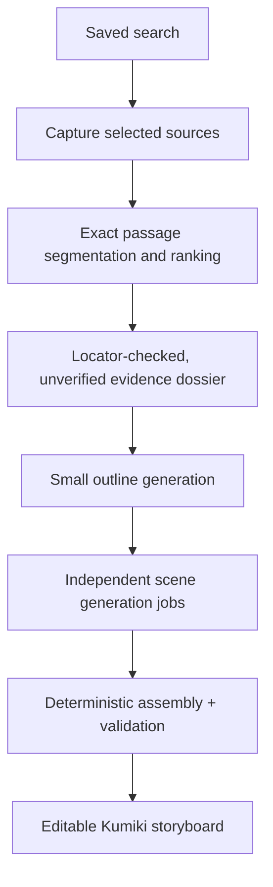

# Resumable local research-to-storyboard jobs — design

Date: 2026-10-23
Status: proposed, awaiting approval
Project: ContentGen Studio

## Intent

Turn a saved source search into a research-backed, editable Kumiki-UI storyboard without overloading a memory-constrained local model or losing all progress when one generation fails. A saved search must be usable independently of any AI call. Each expensive step should be small, observable, separately persisted, and selectively retryable.

## Goals

- Keep the existing explicit user consent for public website capture; use **local models only** for analysis and writing.
- No monolithic request containing all research plus every storyboard field. Provide bounded token budgets, independent task timeouts, and a concurrency limit of **one active inference**.
- Persist captured source text, citations, deterministic evidence, outline, and each scene **before** proceeding to the next stage.
- Resume after a timeout, browser refresh, application restart, invalid JSON, or a failed scene without repeating completed work.
- Preserve every evidence relationship through an existing `parseResearchDossier`/`parsePreproductionPlan` compatible assembled result. Distinguish verbatim quote matching from factual verification.
- Show meaningful progress, partial work, failure reason, retry/cancel/resume controls in Studio.

## Non-goals and anti-goals

- No cloud LLM fallback, automatic model download, arbitrary background crawling, or parallel local-model requests.
- No false claim that an exact quote makes a claim objectively correct; do not silently invent facts or citations to get a green validation result.
- No forced re-fetching or re-running valid stages on retry. No limitless inference retries or retry storms when the machine is low on RAM.
- No rewriting the Kumiki-UI renderer or replacing the existing reviewed storyboard / MP4 production gates.
- No distributed worker infrastructure for this local, single-user deployment.

## Approaches considered

1. **Raise timeouts, reduce one large prompt.** Smallest diff but repeats lengthy inference and entire workflow on failure; insufficient.
2. **Deterministic research, single large story request.** Eliminates many source quote failures, but one oversized creative prompt remains a bottleneck; partial scene work is lost.
3. **Resumable multi-stage jobs, with deterministic research and small creative tasks.** Selected direction. More persistence/assembly code, but incremental reuse, bounded model load, and precise retries solve the actual reliability failure.

## Pipeline and artifacts

### 1. Capture

- Input: an existing immutable saved-search ID and matching brief. Explicit user action authorizes capture. Optionally select source leads, defaulting to a small top-ranked subset.
- Persist a separate immutable capture per successful public page: sanitized URL, selected page text, capture timestamp, content SHA-256, fetch outcome. Continue when a source cannot be captured; expose it as a gap.
- Reuse previously captured bytes on retry; a fresh-source option explicitly creates a new capture version rather than overwriting evidence.
- Retain current safe public HTTPS URL and DNS checks; enforce per-page size and time limits.

### 2. Deterministic evidence

- Segment captures into bounded passages with stable IDs, offsets, and content hashes. Rank for the viewer question using deterministic lexical matching (BM25 or a similarly testable non-LLM ranker), keeping both relevant matches and provenance. This is *selection*, not proof.
- Candidate claims can be verbatim source-derived excerpts with exact capture locators; label them `unverified` and display context. Reject absent quotes and stale hashes. Source-less sentences cannot be promoted to evidence-backed claims.
- The optional local AI research-analysis stage may synthesize *interpretations*, but must select from server-provided passage IDs; invalid references are excluded. It must never block the deterministic baseline from proceeding.
- Persist an evidence dossier independently of later creative stages. Reuse existing dossier/citation validators and explicitly preserve the distinction between model-supported claims and direct excerpts requiring review.

### 3. Outline task

- Send a compact brief plus selected evidence IDs, their short excerpts, and a small budget for acts, narrative structure, and planned scene count.
- The local model outputs *only* an outline intermediate schema; not full shots, teaching sequences, sound, continuity, and all other fields together.
- Validate allowed evidence IDs, required structure, count bounds, question-to-answer progression, and JSON size. Persist a valid outline immediately.

### 4. Scene tasks

- Generate one coherent scene (or one small teaching-sequence unit if a mechanism spans multiple shots) per request, with just its outline brief, local continuity context, relevant evidence, and permitted generic Kumiki intent operators.
- Mint stable scene/shot IDs server-side. Bound input chars, `max_tokens` if supported by the endpoint, output bytes, timeout, and scene count. Save each validated scene atomically. Do not ask the model to rewrite completed scenes while another scene fails.
- Validate concrete readable visuals, before/action/after semantics, teaching mechanics, shot-to-evidence links, and claims before marking a scene complete. Preserve draft-not-approved status.
- A failed scene can be regenerated independently, with validation errors sent back in a short repair prompt (bounded once); already-valid scenes remain intact.

### 5. Deterministic assembly

- Assemble scenes in outline order and generate derived IDs, links, continuity and structural fields where unambiguous. Do not invent factual on-screen claims, numbers, or semantics to fill missing fields.
- Run the existing full `parsePreproductionPlan` / quote validations and scene constraints. If an assembly constraint is not satisfied, classify which scene or outline task needs revision, rather than re-generating the entire video.
- Persist a versioned, content-addressed completed artifact using the existing Studio research draft/result shape so `createSourcedStoryboard` and downstream Kumiki rendering can continue to work.

## Job orchestration

- New local endpoints (final exact paths to be chosen with existing route conventions):
  - `POST /api/contentgen-director/research-jobs` creates a job from a saved search and matching brief, returning `202 { jobId, status }` promptly.
  - `GET /api/contentgen-director/research-jobs/:id` returns the stage, scene completion counts, bounded public progress, retryable error code, and final artifact ID when complete.
  - `POST /api/contentgen-director/research-jobs/:id/resume` requeues incomplete/failed work only.
  - `POST /api/contentgen-director/research-jobs/:id/cancel` stops scheduled work and signals current work to cancel.
  - `POST /api/contentgen-director/research-jobs/:id/scenes/:sceneId/retry` invalidates just the requested scene and its final assembled artifact.
- Persist a per-job manifest, stage files, and a stable fingerprint covering the brief, saved search, selected source captures, schema/prompt version, model settings, and stage inputs. Reuse artifacts only when their dependency fingerprint matches.
- Atomic checkpoints: write a temporary file in the job directory, fsync/rename where available; snapshots are bounded and validated on read. Store under local `data/studio-research/jobs` with private permissions. Keep raw captured page text server-side, never in browser progress payloads or logs.
- Bound both per-artifact and total job storage; provide user-initiated retention cleanup, excluding unrelated saved-search files by default. Log job ID, stage, attempt number, bounded duration, safe error code, and model ID; never log source contents, private prompts, or provider authentication headers.
- States: `queued`, `running` (stage-specific), `needs-review`, `completed`, `failed`, `cancelled`, `paused`. On server restart, previously `running` jobs become `paused` and resume on explicit user action, rather than unexpectedly restarting expensive inference.
- In-process FIFO queue with **one local inference task active globally** for this feature, so pressing multiple buttons cannot create simultaneous GPU/RAM-heavy generations. Capture/network I/O can be bounded separately.
- Browser disconnect only stops listening; it does not abort accepted jobs. Explicit Cancel is required. Poll while viewing the page, then restore existing job progress from persistent state.

## Retry, fallback, and failure handling

- Classify errors by stage and category: source blocked/unavailable, transient network/server, inference timeout, local model OOM/unavailable, invalid JSON/schema, evidence mismatch, user cancellation, storage error.
- Retry only transient failures, with at most one automatic retry after short backoff; each task has an overall attempt budget. For malformed scene JSON, allow one bounded repair task using diagnostics rather than blind full regeneration. Quote/citation mismatch is not solved by silently weakening validation.
- If an inference fails again, pause with a specific action (`Retry scene`, `Use different model`, `Edit evidence`, etc.). Optional automatic **local-only** failover may use a secondary model explicitly configured by the user; never switch to a cloud endpoint or silently use an unapproved model.
- Guard against provider operations still consuming resources after an HTTP timeout: serialize all further inference, enforce a cooldown/health check, avoid immediate cascading retry storms.
- A timeout or model failure does not destroy saved search, capture, evidence, outline, or other completed scenes. Changing model settings invalidates only model-dependent stages whose fingerprint differs.

## Studio UX

- **Research:** Search and save leads, inspect captured/unavailable sources, evidence excerpts, and review gaps. Existing saved searches remain restorable.
- **Production job panel:** clearly show `Capture 3/4`, `Evidence ready`, `Outline ready`, `Scenes 4/6`, `Assembly pending`; elapsed time and stage-level failure details with privacy-safe codes.
- **Actions:** Cancel, Resume, Retry failed step, Change local model, Open completed storyboard. For a failed scene, permit scene-only retry; keep prior scenes visible as partial drafts with a prominent `Incomplete` label.
- After an app refresh/restart, restore job state from the server; never promise progress that exists only in React state.
- Do not mark incomplete/unchecked work as approved. Preserve existing manual review and export preflight.

## Migration and compatibility

- Leave old immutable `search_*.json` and completed `research_*.json` readable. New jobs use versioned manifests and stage artifacts; no data migration or deletion is required.
- Keep the legacy finished-result response shape via an adapter after successful assembly. Only the `POST /research-draft` path should be retired once the new job flow is tested; do not break active saved artifacts.
- Keep the local provider configuration from Settings. A future dedicated `secondary local model` setting is optional, and should be explicit before automatic failover is enabled.

## Tests and acceptance criteria

- Unit: stable passage IDs, hash/locator quote checks, passage ranking, bounded prompt builders, dependency fingerprint invalidation, manifest/schema validation, scene assembly, and no invented claim IDs.
- Integration with stubbed local endpoints: all stages succeed; first scene times out then retry succeeds; final scene invalid JSON; two concurrent job submissions still serialize inference; cancelled job never schedules another task; browser disconnect does not abort accepted jobs; restart mid-scene and resume without redoing valid earlier stages; changed model reuses capture/evidence; model OOM results in paused actionable job; no implicit cloud failover.
- UI: stage progress, resume after reload, retry one scene, gaps/needs-review labels, and successful existing `Create sourced storyboard` handoff.
- Functional gate: create a storyboard from an existing saved search on a 24 GB Mac using a configured small local model; a 3-minute timeout in scene 3 of 6 must leave previously completed scenes intact, display a recoverable error, and succeed after only scene 3+ resume/retry.

## Open decision

Should retry exhaustion stop for explicit user action, or automatically fail over to a user-configured secondary **local** model when available? Recommendation: automatic only when the user has explicitly chosen a secondary model and opted in; manual intervention otherwise.
